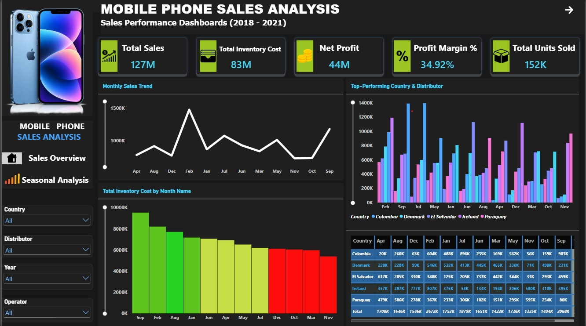
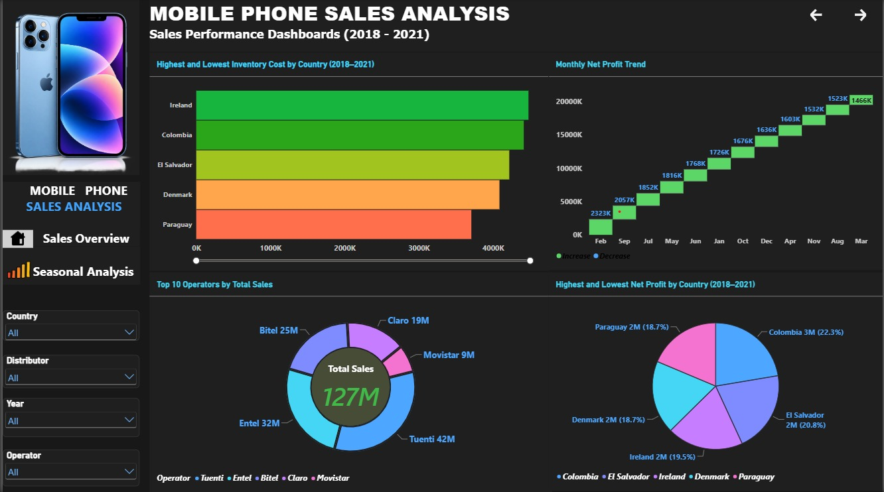
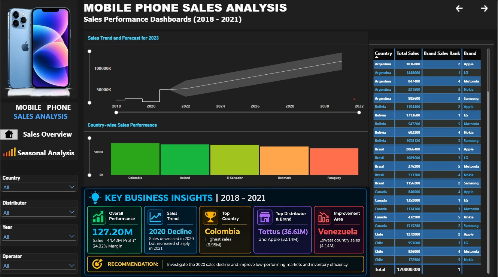

# 📱 Mobile Phone Sales Analysis Dashboard

## 📌 Project Overview
This project focuses on analyzing mobile phone sales performance from 2018 to 2021 using Microsoft Power BI.

The dashboard provides insights into sales performance, inventory costs, net profit, profit margins, country-wise sales and distributor performance.

## 🛠️ Tools & Technologies
- Microsoft Power BI
- Power Query
- DAX (Data Analysis Expressions)
- Data Cleaning
- Data Visualization
- Interactive Dashboards

## 📊 Key Performance Indicators (KPIs)
- Total Sales: 127.20M
- Total Inventory Cost: 83M
- Net Profit: 44.42M
- Profit Margin: 34.92%
- Total Units Sold: 152K

## 📈 Dashboard Analysis

### 1. Sales Overview
- Monthly Sales Trends
- Country-wise Sales Performance
- Top Performing Countries
- Distributor Performance
- Inventory Cost Analysis

### 2. Seasonal Analysis
- Sales Forecast
- Country-wise Sales Comparison
- Monthly Net Profit Trends
- Top 10 Operators by Sales
- Highest and Lowest Net Profit by Country

## 💡 Key Business Insights
- Overall sales reached approximately 127.20M.
- Net profit was approximately 44.42M.
- Profit margin was 34.92%.
- Sales declined in 2020 and recovered sharply in 2021.
- Colombia recorded the highest country sales in the dashboard.

## 🖼️ Dashboard Preview

### Sales Overview

### Seasonal Analysis

### Sales Forecast & Business Insights

## 📁 Project Files
- Power BI dashboard (.pbix)
- Dashboard screenshots

## 👨‍💻 Author
**Deepak Kumar Saha**

- GitHub: https://github.com/DeepakBCA07
- LinkedIn: https://www.linkedin.com/in/deepak-kumar-saha01
- Email: dksaha2001@gmail.com
